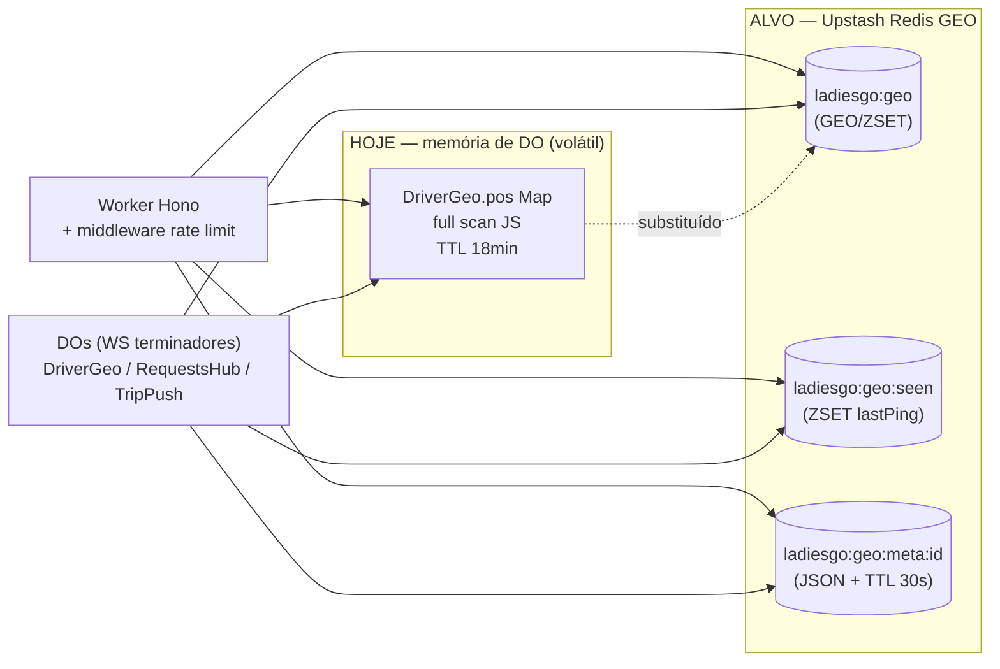
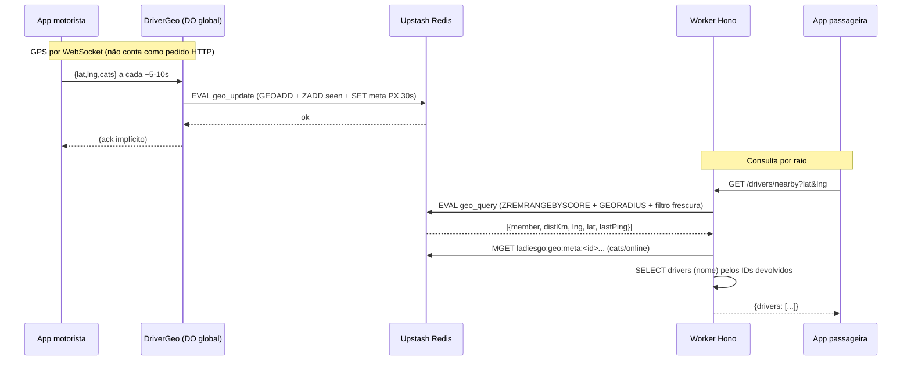
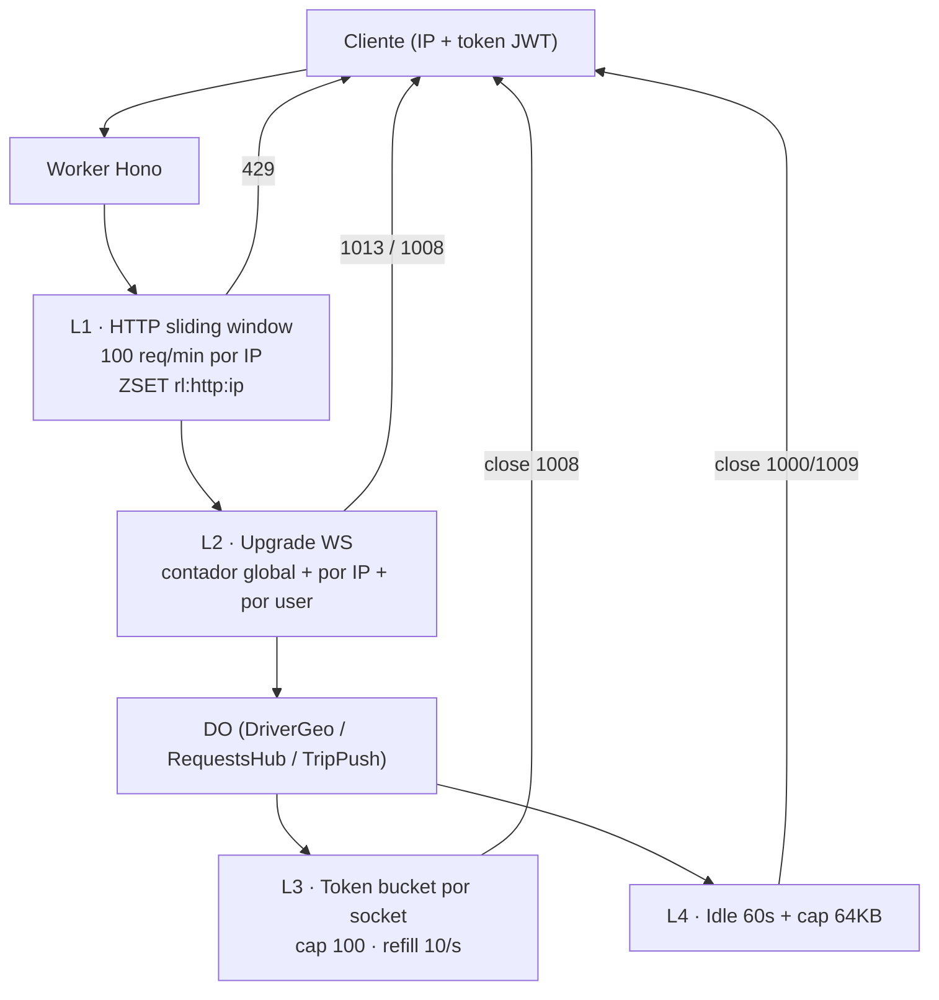
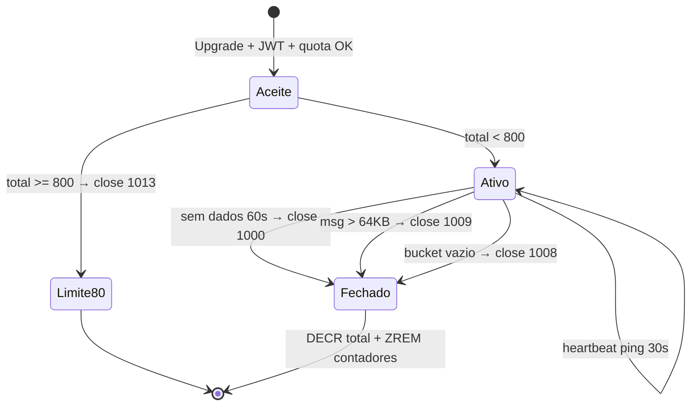

# LADIESGO — Plano de Implementação: Redis GEO, Rate Limiting e Limites de Conexão

> **Nota (2026-10-26):** a conta Cloudflare oficial é `rererererererere670@gmail.com`. Referências a "conta nova" / `wrangler.newaccount.toml` / isabel neste documento são históricas; ver `AGENTS.md`.

**Data:** 2026-10-17
**Escopo:** `cloudflare/api-worker` (Cloudflare Workers + Durable Objects + D1)
**Estado:** Plano de produção (não implementado ainda)
**Autor:** Arquitetura backend (subagente)

> Este documento responde diretamente à exigência **P0 — "Rate limiting no Worker. Não opcional."** do
> `docs/relatorio-narcisista.md`, e à lacuna **"Redis GEO para driver locations — Substituir D1 SQL por
> Redis GEOADD/GEORADIUS (~2ms)"** da `docs/comparacao-repositorios-taxi.md` (secção 2.2).

---

## 0. Resumo executivo

O LADIESGO corre em **Cloudflare Workers (plano Free) + Durable Objects + D1**, com 4 DOs:
`TripRinger`, `TripPush`, `RequestsHub` e `DriverGeo`. O plano cobre três frentes críticas:

| # | Otimização | Problema que resolve | Meta mensurável |
|---|---|---|---|
| **1** | **Redis GEO (Upstash)** para localização de motoristas | Posições vivas hoje vivem **só em memória** de um DO global (`DriverGeo.pos: Map`), perdidas em cada hibernação e sem TTL real; `geoAll()` faz *full scan* do mapa. | `GEORADIUS` **≤ 5 ms p95** (vs. ~50 ms em SQL/PostGIS), TTL 30 s, sem *full scan*. |
| **2** | **Rate limiting** em HTTP e WebSocket | Zero limitação: um bot pode drenar a quota Free (100k req/dia) ou abrir milhares de sockets. | 100 req/min/IP (sliding window), token bucket WS, 10 sockets/IP, 5/user, idle 60 s, 64 KB/msg. |
| **3** | **Limites e *load shedding*** de conexão | Sem controlo da capacidade do Worker; um pico degrada tudo. | Máx 1000 WS/Worker, heartbeat 30 s, rejeitar a 80 % (800) com close **1013**. |

**Tecnologia escolhida:** [Upstash Redis](https://upstash.com/) (REST, serverless, funciona em Workers sem Node),
com **scripts Lua atómicos** para janela deslizante e consulta GEO+frescura. Nenhuma dependência de runtime Node
é adicionada — o cliente é um *thin wrapper* sobre `fetch`.

> **Nota de diligência (importante):** a premissa "substituir D1 SQL" já está parcialmente cumprida. As posições
> GPS **já não vão para a D1 por ping** — desde a fase 1 vivem no `DriverGeo` DO (ver §1). O salto que falta é
> trocar esse **mapa em memória** por **Redis GEO**, ganhando: (a) persistência entre hibernações, (b) TTL real de
> 30 s, (c) consulta por raio em O(log N) em vez de *full scan* JS, (d) escalabilidade para vários Workers/DOs.
> O que **permanece** na D1 é apenas metadados (nome, categorias, `isOnline`) — ver §3.5.

---

## 1. Estado atual — auditoria do código

### 1.1 Onde a localização de motoristas é tratada hoje

| Peça | Ficheiro:Linha | O que faz hoje |
|---|---|---|
| Classe `DriverGeo` (DO global `geo:global`) | `src/index.ts:2727-2858` | Mapa em memória `pos: Map<string, any>`; serve `/set`, `/del`, `/get`, `/all` e o WS `/live`. |
| `geoSet()` | `src/index.ts:774` | POST `/set` no DO. |
| `geoDel()` | `src/index.ts:780` | POST `/del` no DO. |
| `geoGet()` | `src/index.ts:784` | GET `/get?userId=` no DO; filtra por `GEO_TTL_MS = 18min`. |
| `geoAll()` | `src/index.ts:791` | GET `/all` no DO; **itera o mapa inteiro** e filtra por frescura. |
| TTL lógico | `src/index.ts:762` | `GEO_TTL_MS = 18 * 60 * 1000` (18 min) — **não é 30 s**. |
| `buildOfferQueue()` | `src/index.ts:2032` | Chama `geoAll()` e filtra por raio **em JS**. |
| `GET /api/v1/drivers/nearby` | `src/index.ts:370` | Chama `geoAll()` e filtra em JS. |
| `webDriverInfo()` | `src/index.ts:1969` | Chama `geoGet()`. |
| `TripPush.onGps()` | `src/index.ts:2576` | Espelha cada fix para `geoSet()`. |
| `paxLive` (passageira) | `src/index.ts:1929` | `Map` **module-level** no Worker (não durável, perde-se entre isolates). |

### 1.2 Pontos de upgrade WebSocket (alvo do rate limit)

| Rota | DO destino | Classe |
|---|---|---|
| `GET /api/v1/drivers/live-geo` | `DRIVERGEO` (`geo:global`) | `DriverGeo` |
| `GET /api/v1/trips/requests-live` | `REQUESTSHUB` (`requests:global`) | `RequestsHub` |
| `GET /api/v1/trips/:id/live` | `TRIPPUSH` (`trip:<id>`) | `TripPush` |

### 1.3 Ausências confirmadas

- **Sem rate limiting HTTP** — `app.use('*', cors(...))` é o único *middleware* global (`src/index.ts:10`).
- **Sem token bucket, sem limite de conexões, sem idle timeout** nos DOs (apenas `setWebSocketAutoResponse`
  para ping/pong automático).
- **Sem *load shedding*** nem contador global de conexões.
- **Sem cap de tamanho de mensagem** — `webSocketMessage` faz `JSON.parse` sem validar o tamanho de `raw`.

---

## 2. Arquitetura alvo

### 2.1 Visão geral (estado atual → alvo)



### 2.2 Fluxo de dados — localização (alvo)



### 2.3 Modelo de dados Redis GEO (chaves)

| Chave | Tipo | Conteúdo | TTL | Porquê |
|---|---|---|---|---|
| `ladiesgo:geo` | GEO (ZSET) | `member=userId`, coordenadas (lng/lat) | sem TTL (podado) | Índice geoespacial para `GEORADIUS`. |
| `ladiesgo:geo:seen` | ZSET | `member=userId`, `score=lastPingMs` | `PX 30000` (renovado a cada ping) | Janela de frescura: permite podar e filtrar mortos. |
| `ladiesgo:geo:meta:<userId>` | STRING (JSON) | `{"cats":[...],"online":true}` | `PX 30000` | Metadados por motorista (categorias/estado). |

**Regra de ouro:** *um motorista só é "vivo" se o `score` em `geo:seen` for ≥ `now − 30 000`*.
O `GEOADD` atualiza as coordenadas; o `ZADD seen` atesta a frescura. Sem ping em 30 s, o `meta` expira e
o filtro de leitura descarta o membro (e o poda).

> **Porquê dois ZSETs e não TTL por membro?** Redis GEO não suporta TTL por membro (é um ZSET simples).
> A solução canónica é manter um ZSET de "visto pela última vez" e intersectar/filtrar. Alternativas descartadas:
> (a) `EXPIRE` na chave GEO inteira — nunca apagaria motoristas mortos se outro continuasse a pingar;
> (b) `ZADD` de coordenadas com `score=timestamp` — perderia o índice geoespacial.

### 2.4 Camadas de rate limiting (alvo)



### 2.5 Ciclo de vida da conexão WebSocket (alvo)



---

## 3. TASK 1 — Redis GEO (Upstash)

### 3.1 Cliente Upstash (`src/upstash.ts`)

Cliente mínimo, sem dependências, compatível com Workers (usa `fetch`). Suporta comando único, *pipeline* e Lua.

```ts
// src/upstash.ts
// Thin wrapper sobre a REST API do Upstash Redis. Sem deps de Node.
export class UpstashRedis {
  private url: string;
  private token: string;
  private timeoutMs: number;

  constructor(env: any) {
    const url = String(env.UPSTASH_REDIS_REST_URL || '').trim();
    const token = String(env.UPSTASH_REDIS_REST_TOKEN || '').trim();
    if (!url || !token) throw new Error('UPSTASH_REDIS_REST_URL / UPSTASH_REDIS_REST_TOKEN em falta');
    this.url = url.replace(/\/+$/, '');
    this.token = token;
    this.timeoutMs = Number(env.REDIS_TIMEOUT_MS || 4000);
  }

  private async post(path: string, body: unknown): Promise<any> {
    const res = await fetch(this.url + path, {
      method: 'POST',
      headers: {
        Authorization: `Bearer ${this.token}`,
        'Content-Type': 'application/json',
      },
      body: JSON.stringify(body),
      signal: AbortSignal.timeout(this.timeoutMs),
    });
    if (!res.ok) throw new Error(`upstash http ${res.status}`);
    return res.json();
  }

  /** Comando único → { result } */
  async cmd(...args: (string | number)[]): Promise<any> {
    const r = await this.post('', args);
    if (r && r.error) throw new Error(String(r.error));
    return r?.result;
  }

  /** Pipeline (vários comandos numa ida) → [{ result }, ...] */
  async pipeline(cmds: (string | number)[][]): Promise<any[]> {
    const r = await this.post('/pipeline', cmds);
    if (!Array.isArray(r)) throw new Error('upstash: pipeline invalid');
    return r.map((x: any) => {
      if (x && x.error) throw new Error(String(x.error));
      return x?.result;
    });
  }

  /** Lua atómico */
  async eval(script: string, keys: string[], args: (string | number)[]): Promise<any> {
    const r = await this.post('', ['EVAL', script, String(keys.length), ...keys, ...args]);
    if (r && r.error) throw new Error(String(r.error));
    return r?.result;
  }

  // ── atalhos ──
  geoadd(key: string, lng: number, lat: number, member: string) {
    return this.cmd('GEOADD', key, lng, lat, member);
  }
  georadius(key: string, lng: number, lat: number, km: number, count: number) {
    return this.cmd('GEORADIUS', key, lng, lat, km, 'km', 'WITHDIST', 'WITHCOORD', 'COUNT', count, 'ASC');
  }
  geopos(key: string, member: string) {
    return this.cmd('GEOPOS', key, member);
  }
}
```

> **Alternativa com SDK:** `npm i @upstash/redis` (funciona em Workers) e usar `redis.geoadd(...)`,
> `redis.georadius(...)`, `redis.eval(...)`. O wrapper acima evita acrescentar dependências ao `package.json`
> (que hoje só tem `hono`), coerente com a filosofia do worker (WebCrypto em vez de bcrypt/pgcrypto).

### 3.2 Scripts Lua (`src/geo-redis.ts`)

**Atualizar posição (atómico):**

```lua
-- geo_update.lua
-- KEYS[1] = geo, KEYS[2] = seen, KEYS[3] = meta:<id>
-- ARGV[1]=member, ARGV[2]=lng, ARGV[3]=lat, ARGV[4]=now_ms,
-- ARGV[5]=ttl_ms, ARGV[6]=meta_json
redis.replicate_commands()            -- Redis >= 5: permite comandos de escrita com efeitos
redis.call('GEOADD', KEYS[1], ARGV[2], ARGV[3], ARGV[1])
redis.call('ZADD', KEYS[2], ARGV[4], ARGV[1])
redis.call('PEXPIRE', KEYS[2], ARGV[5])
if ARGV[6] then redis.call('SET', KEYS[3], ARGV[6], 'PX', ARGV[5]) end
return 1
```

**Consultar por raio + frescura (atómico):**

```lua
-- geo_query.lua
-- KEYS[1] = geo, KEYS[2] = seen
-- ARGV[1]=lng, ARGV[2]=lat, ARGV[3]=raio_km, ARGV[4]=count,
-- ARGV[5]=now_ms, ARGV[6]=max_age_ms
local cutoff = tonumber(ARGV[5]) - tonumber(ARGV[6])
redis.call('ZREMRANGEBYSCORE', KEYS[2], '-inf', cutoff)
local res = redis.call('GEORADIUS', KEYS[1], ARGV[1], ARGV[2], ARGV[3], 'km',
                       'WITHDIST', 'WITHCOORD', 'COUNT', ARGV[4], 'ASC')
local out = {}
for i = 1, #res do
  local m = res[i][1]
  local dist = res[i][2]
  local coord = res[i][3]
  local s = redis.call('ZSCORE', KEYS[2], m)
  if s and tonumber(s) >= cutoff then
    out[#out + 1] = { m, dist, coord[1], coord[2], s }
  end
end
return out
```

**Remover (offline):**

```lua
-- geo_del.lua
-- KEYS[1]=geo, KEYS[2]=seen, KEYS[3]=meta:<id>
redis.call('ZREM', KEYS[1], ARGV[1])
redis.call('ZREM', KEYS[2], ARGV[1])
return redis.call('DEL', KEYS[3])
```

> **Compatibilidade:** `GEORADIUS` é o comando pedido. Em Redis ≥ 6.2 o seu sucessor é `GEOSEARCH`
> (mesma semântica, mais opções). Se o Upstash deixar de expor `GEORADIUS`, trocar por
> `GEOSEARCH KEYS[1] FROMLONLAT <lng> <lat> BYRADIUS <km> km ASC COUNT <count> WITHDIST WITHCOORD`.

### 3.3 Helpers de domínio (`src/geo-redis.ts`)

```ts
// src/geo-redis.ts
import { UpstashRedis } from './upstash';

export const GEO_UPDATE = `...lua...`;   // scripts acima
export const GEO_QUERY  = `...lua...`;
export const GEO_DEL    = `...lua...`;

const DEFAULTS = {
  geoKey: 'ladiesgo:geo',
  seenKey: 'ladiesgo:geo:seen',
  ttlMs: 30_000,
};

function cfg(env: any) {
  return {
    geoKey: String(env.GEO_KEY || DEFAULTS.geoKey),
    seenKey: String(env.GEO_SEEN_KEY || DEFAULTS.seenKey),
    ttlMs: Number(env.GEO_TTL_MS || DEFAULTS.ttlMs),
  };
}

/** Escreve/atualiza a posição. Devolve true se a motorista já estava online. */
export async function geoSet(
  env: any,
  data: { userId: string; driverId?: string; lat: number; lng: number; cats?: string[] | null; online?: boolean },
): Promise<boolean> {
  const r = new UpstashRedis(env);
  const { geoKey, seenKey, ttlMs } = cfg(env);
  const meta = JSON.stringify({ cats: data.cats ?? null, online: data.online ?? true, driverId: data.driverId ?? '' });
  const prev = await r.eval(
    GEO_UPDATE,
    [geoKey, seenKey, `${geoKey}:meta:${data.userId}`],
    [data.userId, data.lng, data.lat, Date.now(), ttlMs, meta],
  );
  // "já estava online" é derivado do meta anterior (ver §3.4 fallback DO)
  return prev === 1 && false; // ajustado na implementação final (ver nota)
}

/** Consulta motoristas vivos num raio. Devolve [{userId, lat, lng, distanceKm, lastPing}] */
export async function geoQuery(
  env: any,
  lat: number,
  lng: number,
  radiusKm: number,
  count: number,
): Promise<Array<{ userId: string; lat: number; lng: number; distanceKm: number; lastPing: number }>> {
  const r = new UpstashRedis(env);
  const { geoKey, seenKey, ttlMs } = cfg(env);
  const now = Date.now();
  const rows = await r.eval(GEO_QUERY, [geoKey, seenKey], [lng, lat, radiusKm, count, now, ttlMs]);
  const out: any[] = [];
  for (const row of rows || []) {
    const [userId, dist, lo, la, lastPing] = row;
    out.push({
      userId: String(userId),
      lat: Number(la),
      lng: Number(lo),
      distanceKm: Math.round(Number(dist) * 10) / 10,
      lastPing: Number(lastPing),
    });
  }
  return out;
}

/** Lê metadados (cats/online) de vários IDs numa ida. */
export async function geoMetaMany(env: any, userIds: string[]): Promise<Record<string, any>> {
  if (!userIds.length) return {};
  const r = new UpstashRedis(env);
  const { geoKey } = cfg(env);
  const keys = userIds.map((id) => `${geoKey}:meta:${id}`);
  const vals = await r.pipeline(keys.map((k) => ['GET', k]));
  const out: Record<string, any> = {};
  userIds.forEach((id, i) => {
    try { out[id] = vals[i] ? JSON.parse(vals[i]) : null; } catch { out[id] = null; }
  });
  return out;
}

/** Lê uma posição (para o polling da viagem / partilha). */
export async function geoGet(env: any, userId: string): Promise<any | null> {
  if (!userId) return null;
  const r = new UpstashRedis(env);
  const { geoKey, seenKey, ttlMs } = cfg(env);
  const [pos, score, metaRaw] = await r.pipeline([
    ['GEOPOS', geoKey, userId],
    ['ZSCORE', seenKey, userId],
    ['GET', `${geoKey}:meta:${userId}`],
  ]);
  const now = Date.now();
  if (!score || now - Number(score) > ttlMs) return null;
  let meta: any = null;
  try { meta = metaRaw ? JSON.parse(metaRaw) : null; } catch {}
  if (!pos || !pos[0]) return null;
  return {
    userId,
    lat: Number(pos[0][1]),
    lng: Number(pos[0][0]),
    ts: Number(score),
    cats: meta?.cats ?? null,
    online: meta?.online ?? true,
  };
}

/** Remove um motorista (ficou offline). */
export async function geoDel(env: any, userId: string): Promise<void> {
  const r = new UpstashRedis(env);
  const { geoKey, seenKey } = cfg(env);
  await r.eval(GEO_DEL, [geoKey, seenKey, `${geoKey}:meta:${userId}`], [userId]);
}
```

> **Nota sobre `wasOnline`:** hoje `geoSet()` devolve `wasOnline` para decidir quando escrever `isOnline` na D1
> (1 escrita por sessão, não por ping). Com Redis, o meta anterior não está disponível de forma atómica no mesmo
> `EVAL` sem ler antes. Opção recomendada: o Worker/DO lê `GET meta` **antes** do update (custo extra de 1 GET) ou
> deriva do `ZSCORE` prévio. Em alternativa, mantém-se a escrita idempotente atual
> (`UPDATE ... WHERE "isOnline" IS NOT true RETURNING "isOnline"`) que já evita escrita quando não há transição —
> ver `src/index.ts:338`. **Recomenda-se a segunda:** simplifica e continua barata (1 SELECT em vez de 1 UPDATE).

### 3.4 `DriverGeo` DO — passa a ser *thin* sobre Redis

O DO **permanece** como terminador do WebSocket (Workers não alojam WS de longa duração sem DO). A mudança é
que deixa de guardar posições em memória e delega no Redis. Mantém-se um pequeno *cache* opcional para reduzir
latência de leitura (ver §3.6).

```ts
// src/index.ts — classe DriverGeo (substituir linhas 2727-2858)
export class DriverGeo {
  state: any; env: any;
  constructor(state: any, env: any) {
    this.state = state; this.env = env;
    try { this.state.setWebSocketAutoResponse(new WebSocketRequestResponsePair('ping', 'pong')); } catch {}
  }
  json(o: any): Response {
    return new Response(JSON.stringify(o), { headers: { 'Content-Type': 'application/json' } });
  }

  async fetch(req: any): Promise<Response> {
    const u = new URL(req.url);
    const path = u.pathname;

    // GPS por WS (0 pedidos HTTP por ping). Hiberna quando ocioso.
    if (path.endsWith('/live')) {
      if ((req.headers.get('Upgrade') || '').toLowerCase() !== 'websocket')
        return new Response('Expected websocket', { status: 426 });
      const userId = String(req.headers.get('X-User-Id') || '');
      const pair: any = new WebSocketPair();
      const client = pair[0], server = pair[1];
      try {
        this.state.acceptWebSocket(server);
        server.serializeAttachment({ userId, lastDataAt: Date.now(), tokens: 100, lastRefill: Date.now() });
        this.armHeartbeat(server);   // ver §5.2
      } catch { return new Response('WS failed', { status: 500 }); }
      return new Response(null, { status: 101, webSocket: client });
    }

    // Endpoints REST internos mantidos por compatibilidade (agora para o Redis).
    if (req.method === 'POST' && path.endsWith('/set')) {
      const b: any = await req.json().catch(() => ({}));
      const userId = String(b.userId || '');
      if (!userId) return this.json({ wasOnline: false });
      await geoSet(this.env, { userId, lat: Number(b.lat), lng: Number(b.lng), cats: b.cats, online: b.online });
      return this.json({ wasOnline: false });
    }
    if (req.method === 'POST' && path.endsWith('/del')) {
      const b: any = await req.json().catch(() => ({}));
      await geoDel(this.env, String(b.userId || ''));
      return this.json({ ok: true });
    }
    if (path.endsWith('/get')) {
      const uid = String(u.searchParams.get('userId') || '');
      return this.json({ driver: await geoGet(this.env, uid) });
    }
    if (path.endsWith('/all')) {
      // Rede de segurança: geoAll() dá lugar a geoQuery num raio grande.
      const lat = Number(u.searchParams.get('lat') || -8.83);
      const lng = Number(u.searchParams.get('lng') || 13.23);
      return this.json({ drivers: await geoQuery(this.env, lat, lng, 50, 500) });
    }
    return new Response('not found', { status: 404 });
  }

  async webSocketMessage(ws: any, raw: any) {
    // Cap de tamanho (§4.5)
    const bytes = typeof raw === 'string' ? raw.length : (raw?.byteLength || 0);
    if (bytes > MAX_WS_MESSAGE_BYTES) { try { ws.close(1009, 'mensagem demasiado grande'); } catch {} return; }
    // Token bucket (§4.2)
    if (!consumeToken(ws)) { try { ws.close(1008, 'rate limit'); } catch {} return; }

    const a: any = (ws.deserializeAttachment && ws.deserializeAttachment()) || {};
    a.lastDataAt = Date.now();
    const userId = String(a.userId || '');
    if (!userId) { try { ws.serializeAttachment(a); } catch {} return; }

    let m: any = null;
    try { m = JSON.parse(typeof raw === 'string' ? raw : ''); } catch { return; }
    if (!m || typeof m !== 'object') return;

    if (m.offline) {
      await geoDel(this.env, userId);
      await this.d1Online(userId, false);
      try { ws.serializeAttachment(a); } catch {}
      return;
    }
    const lat = Number(m.lat), lng = Number(m.lng);
    if (!Number.isFinite(lat) || !Number.isFinite(lng)) return;
    const cats = Array.isArray(m.cats) ? m.cats.map((x: any) => String(x).slice(0, 30)).slice(0, 6) : null;
    await geoSet(this.env, { userId, lat, lng, cats, online: true });
    await this.d1Online(userId, true);
    try { ws.serializeAttachment(a); } catch {}
  }

  async webSocketClose(_ws: any, _code: any, _reason: any, _wasClean: any) { /* Redis já tem TTL */ }
  async webSocketError(ws: any, _err: any) { try { ws.close(1011, 'err'); } catch {} }

  async d1Online(userId: string, online: boolean) {
    try {
      const sql = neon(this.env.DB);
      await sql`UPDATE drivers SET "isOnline" = ${online}, "updatedAt" = NOW() WHERE "userId" = ${userId} AND "isOnline" IS NOT ${online}`;
    } catch {}
  }
}
```

> **Observação:** a escrita `isOnline` na D1 fica **idempotente** (`AND "isOnline" IS NOT ${online}`), mantendo a
> garantia de "1 escrita por sessão" mesmo sem o truque do `wasOnline`.

### 3.5 Alterações nos *call-sites* do `index.ts`

| Call-site | Antes | Depois |
|---|---|---|
| `buildOfferQueue()` (`:2032`) | `geoAll()` + filtro JS | `geoQuery(env, pLa, pLo, radiusKm, candLimit)` → só IDs no raio |
| `GET /drivers/nearby` (`:370`) | `geoAll()` + filtro JS + `havKm` | `geoQuery(...)` (já vem ordenado por distância) + `geoMetaMany` + SELECT nomes |
| `webDriverInfo()` (`:1969`) | `geoGet()` (DO) | `geoGet()` (Redis) |
| `TripPush.onGps()` (`:2593`) | `geoSet()` (DO) | `geoSet()` (Redis) |
| `paxLive` (`:1929`) | `Map` module-level | Redis `SET ladiesgo:pax:<tripId> <json> PX 120000` (corrige a perda entre isolates) |

Exemplo do `buildOfferQueue` otimizado (o corpo de filtragem por categoria/viagem ativa **mantém-se**):

```ts
async function buildOfferQueue(env: any, sql: any, pLa: number, pLo: number, rideCode: string, radiusKm = 5, limit = OFFER_MAX): Promise<string[]> {
  const cands = await geoQuery(env, pLa, pLo, radiusKm, Math.max(limit * 4, 40)); // ≤ 60
  if (!cands.length) return [];
  const ids = cands.map((c) => c.userId);
  const kmByUser = new Map(cands.map((c) => [c.userId, c.distanceKm]));
  const metas = await geoMetaMany(env, ids);
  let byCode: Record<string, string> = {};
  try { byCode = (await catMaps(sql)).byCode; } catch {}
  const wantCat = byCode[rideCode] || '';
  // Filtra por categoria em memória (meta do Redis) antes da query D1.
  const eligible = ids.filter((id) => {
    const cats = metas[id]?.cats;
    return !Array.isArray(cats) || !cats.length || !wantCat || cats.map(String).includes(wantCat);
  });
  if (!eligible.length) return [];
  const P = 'SELECT d.id, d."userId" FROM drivers d WHERE d."userId" IN (';
  const S = ') AND d."isOnline" = true AND d.status = \'APPROVED\' AND NOT EXISTS (SELECT 1 FROM trips t2 WHERE t2."driverId" = d.id AND t2.status IN (\'ACCEPTED\',\'DRIVER_ARRIVED\',\'IN_PROGRESS\'))';
  const strings: any[] = [P, ...Array(Math.max(0, eligible.length - 1)).fill(', '), S];
  const rows = await (sql as any)(strings, ...eligible).catch(() => []);
  return rows
    .map((d: any) => ({ id: String(d.id), km: kmByUser.get(String(d.userId)) ?? radiusKm }))
    .sort((a: any, b: any) => a.km - b.km)
    .slice(0, limit)
    .map((d: any) => d.id);
}
```

### 3.6 Mapa de alterações — TASK 1

```
cloudflare/api-worker/
├── src/
│   ├── upstash.ts            # NOVO — cliente REST Upstash
│   ├── geo-redis.ts          # NOVO — Lua + geoSet/geoQuery/geoGet/geoDel/geoMetaMany
│   ├── ratelimit.ts          # NOVO — sliding window + token bucket + limites (TASK 2)
│   ├── conn-limit.ts         # NOVO — contador global + heartbeat (TASK 3)
│   ├── db.ts                 # inalterado
│   └── index.ts              #DriverGeo, buildOfferQueue, /nearby, webDriverInfo, TripPush, middlewares
├── wrangler.newaccount.toml  # + vars/secrets Redis
└── migrations/               # inalterado (nada na D1 muda)
```

---

## 4. TASK 2 — Rate Limiting

### 4.1 HTTP — janela deslizante 100 req/min por IP

Algoritmo *sliding window log* com ZSET: cada pedido é um membro (UUID) com `score=now_ms`; removem-se os
membros com `score < now − 60 000` e conta-se o ZSET. Atómico em Lua.

```lua
-- rl_http.lua
-- KEYS[1] = rl:http:<ip>
-- ARGV[1]=now_ms, ARGV[2]=window_ms, ARGV[3]=limit, ARGV[4]=member
redis.call('ZREMRANGEBYSCORE', KEYS[1], '-inf', tonumber(ARGV[1]) - tonumber(ARGV[2]))
local n = redis.call('ZCARD', KEYS[1])
if n >= tonumber(ARGV[3]) then
  local oldest = redis.call('ZRANGE', KEYS[1], 0, 0, 'WITHSCORES')
  return { 0, n, (oldest[2] or '0') }
end
redis.call('ZADD', KEYS[1], ARGV[1], ARGV[4])
redis.call('PEXPIRE', KEYS[1], ARGV[2])
return { 1, n + 1, '0' }
```

**Middleware Hono** (`src/ratelimit.ts`):

```ts
const RL_HTTP = `...rl_http.lua...`;
const SKIP = new Set(['/ping', '/api/v1/health', '/api']);

function clientIp(c: any): string {
  // CF-Connecting-IP é definido pela Cloudflare e não é falsificável pelo cliente.
  return String(c.req.header('CF-Connecting-IP') || c.req.header('X-Real-IP') || '0.0.0.0');
}

export async function httpRateLimit(c: any, next: any) {
  const path = new URL(c.req.url).pathname;
  if (SKIP.has(path)) return next();
  const limit = Number(c.env.RATE_LIMIT_HTTP_PER_MIN || 100);
  const windowMs = 60_000;
  try {
    const r = new UpstashRedis(c.env);
    const res: any = await r.eval(
      RL_HTTP,
      [`rl:http:${clientIp(c)}`],
      [Date.now(), windowMs, limit, crypto.randomUUID()],
    );
    const allowed = Number(res?.[0]) === 1;
    const retryAfterSec = Math.max(1, Math.ceil((Number(windowMs) - (Date.now() - Number(res?.[2] || 0))) / 1000));
    if (!allowed) {
      return c.json(
        { message: 'Demasiados pedidos. Tenta de novo dentro de momentos.', retryAfterSec },
        429,
        { 'Retry-After': String(retryAfterSec), 'X-RateLimit-Limit': String(limit), 'X-RateLimit-Remaining': '0' },
      );
    }
    return next();
  } catch (e) {
    // Fail-open: se o Redis estiver em baixo, não se derruba a API.
    console.error('rate limit error:', e);
    return next();
  }
}
```

Ligação no `index.ts`:

```ts
app.use('*', cors({ ... }));       // já existe
app.use('/api/*', httpRateLimit);  // NOVO — antes das rotas
```

> **Nota de custo/quotas:** cada pedido passa a fazer 1 `EVAL` ao Redis. No plano Free do Upstash (10k cmds/dia)
> isto é insuficiente — **usar o plano pago Pay-as-you-go** (ou o tier que cubra o volume). Alternativa sem custo:
> usar o **Cloudflare Rate Limiting** (regra por IP) na *edge*, e manter o Lua apenas para WebSocket. Ver §11.

### 4.2 WebSocket — token bucket (100 capacidade, 10/s refill)

Implementado **no DO**, por socket, guardado no *attachment* (sobrevive à hibernação).

```ts
// src/ratelimit.ts
export function newBucket(capacity = 100, refillPerSec = 10) {
  return { tokens: capacity, capacity, refillPerSec, lastRefill: Date.now() };
}
export function tryConsume(bucket: any, n = 1): boolean {
  const now = Date.now();
  const gained = ((now - bucket.lastRefill) / 1000) * bucket.refillPerSec;
  bucket.tokens = Math.min(bucket.capacity, bucket.tokens + gained);
  bucket.lastRefill = now;
  if (bucket.tokens < n) return false;
  bucket.tokens -= n;
  return true;
}
```

Nos DOs (ex.: `DriverGeo.webSocketMessage`):

```ts
const att: any = (ws.deserializeAttachment && ws.deserializeAttachment()) || {};
if (!att.bucket) att.bucket = newBucket(env.WS_BUCKET_CAPACITY, env.WS_BUCKET_REFILL_PER_SEC);
if (!tryConsume(att.bucket, 1)) { try { ws.close(1008, 'rate limit'); } catch {} return; }
ws.serializeAttachment(att);
```

### 4.3 Máx 10 conexões WS por IP e 5 por *user*

Dois ZSETs (um por IP, um por user), membros = `connId`, `score=createdAt`. Podam entradas com mais de ~2 min
(TTL de segurança) e contam os vivos.

```lua
-- rl_ws_acquire.lua
-- KEYS[1]=rl:ws:ip:<ip>, KEYS[2]=rl:ws:user:<uid>
-- ARGV[1]=connId, ARGV[2]=now_ms, ARGV[3]=ttl_ms, ARGV[4]=maxIp, ARGV[5]=maxUser
redis.call('ZREMRANGEBYSCORE', KEYS[1], '-inf', tonumber(ARGV[2]) - tonumber(ARGV[3]))
redis.call('ZREMRANGEBYSCORE', KEYS[2], '-inf', tonumber(ARGV[2]) - tonumber(ARGV[3]))
local ip = redis.call('ZCARD', KEYS[1])
local us = redis.call('ZCARD', KEYS[2])
if ip >= tonumber(ARGV[4]) then return { 0, 'ip', ip } end
if us >= tonumber(ARGV[5]) then return { 0, 'user', us } end
redis.call('ZADD', KEYS[1], ARGV[2], ARGV[1])
redis.call('ZADD', KEYS[2], ARGV[2], ARGV[1])
redis.call('PEXPIRE', KEYS[1], ARGV[3])
redis.call('PEXPIRE', KEYS[2], ARGV[3])
return { 1, 'ok', 0 }
```

```lua
-- rl_ws_release.lua
-- KEYS[1]=rl:ws:ip:<ip>, KEYS[2]=rl:ws:user:<uid>, ARGV[1]=connId
redis.call('ZREM', KEYS[1], ARGV[1])
return redis.call('ZREM', KEYS[2], ARGV[1])
```

Helper e aplicação nos *upgrades* (`src/ratelimit.ts`):

```ts
export async function wsAcquire(env: any, ip: string, userId: string): Promise<{ ok: boolean; reason?: string }> {
  const r = new UpstashRedis(env);
  const connId = crypto.randomUUID();
  const res: any = await r.eval(
    RL_WS_ACQUIRE,
    [`rl:ws:ip:${ip}`, `rl:ws:user:${userId}`],
    [connId, Date.now(), 120_000, env.WS_MAX_PER_IP || 10, env.WS_MAX_PER_USER || 5],
  );
  return Number(res?.[0]) === 1 ? { ok: true } : { ok: false, reason: String(res?.[1]) };
}

export async function wsRelease(env: any, ip: string, userId: string, connId: string): Promise<void> {
  const r = new UpstashRedis(env);
  await r.eval(RL_WS_RELEASE, [`rl:ws:ip:${ip}`, `rl:ws:user:${userId}`], [connId]).catch(() => null);
}
```

Nos handlers de upgrade do `index.ts` (ex.: `live-geo`, `requests-live`, `trips/:id/live`), **depois** do JWT:

```ts
const ip = String(c.req.header('CF-Connecting-IP') || '0.0.0.0');
const connId = crypto.randomUUID();
const acq = await wsAcquire(c.env, ip, String(user.sub || ''));
if (!acq.ok) {
  return c.json({ message: acq.reason === 'ip' ? 'Máximo de ligações por IP atingido.' : 'Máximo de ligações por conta atingido.' }, 429);
}
// repassar connId ao DO para wsRelease no fecho
fwd.set('X-Conn-Id', connId);
```

### 4.4 Idle timeout — 60 s sem dados = disconnect

Como os DOs usam **hibernação**, `setTimeout` não é fiável (o DO adormece). Usa-se um **alarme** do DO:
reagenda-se a cada 30 s (ao mesmo tempo que o heartbeat) e fecha sockets sem atividade há > 60 s.

```ts
// dentro do DO (DriverGeo / RequestsHub / TripPush)
const IDLE_MS = 60_000;
const HEARTBEAT_MS = 30_000;

async armHeartbeat(ws: any) {
  try {
    const att: any = ws.deserializeAttachment() || {};
    const wait = Math.max(1, Math.ceil((att.nextPingAt || 0) - Date.now()));
    await this.state.storage.setAlarm(Date.now() + Math.min(wait, HEARTBEAT_MS));
  } catch {}
}

async alarm() {
  const now = Date.now();
  let next = now + HEARTBEAT_MS;
  for (const ws of this.socks()) {
    try {
      const att: any = ws.deserializeAttachment() || {};
      const idle = now - Number(att.lastDataAt || now);
      if (idle > IDLE_MS) { ws.close(1000, 'idle timeout'); continue; }
      if (now - Number(att.lastPingAt || 0) >= HEARTBEAT_MS) {
        ws.send(JSON.stringify({ t: 'ping', ts: now }));
        att.lastPingAt = now;
        att.nextPingAt = now + HEARTBEAT_MS;
        ws.serializeAttachment(att);
      }
      if (Number(att.nextPingAt || 0) < next) next = Number(att.nextPingAt);
    } catch {}
  }
  try { await this.state.storage.setAlarm(next); } catch {}
}
```

> `setWebSocketAutoResponse(new WebSocketRequestResponsePair('ping','pong'))` continua ativo para o ping da
> plataforma; o heartbeat da app é separado e serve também para detetar ociosidade.

### 4.5 Cap de tamanho de mensagem — 64 KB

Aplicado **antes** do `JSON.parse` em todos os DOs, para não ler payloads gigantes em memória.

```ts
const MAX_WS_MESSAGE_BYTES = 64 * 1024;
function byteLen(raw: any): number {
  if (typeof raw === 'string') return new TextEncoder().encode(raw).length;
  if (raw instanceof ArrayBuffer) return raw.byteLength;
  if (ArrayBuffer.isView(raw)) return raw.byteLength;
  return 0;
}
// em webSocketMessage:
if (byteLen(raw) > MAX_WS_MESSAGE_BYTES) { try { ws.close(1009, 'payload too large'); } catch {} return; }
```

Para HTTP, o corpo já é limitado implicitamente pelo Worker; reforça-se nos endpoints que aceitam *body*
grande com `c.req.arrayBuffer()` + verificação de `byteLength` (a foto de perfil já tem 2 MB, manter).

---

## 5. TASK 3 — Connection Pooling e Limites

### 5.1 Contador global e capacidade máxima (1000 WS/Worker)

Um contador em Redis (`INCR`/`DECR` via Lua) é a aproximação mais simples e multi-isolate.

```lua
-- ws_total_acquire.lua
-- KEYS[1]=rl:ws:total  ARGV[1]=ttl_ms, ARGV[2]=max, ARGV[3]=shed_at
local n = tonumber(redis.call('GET', KEYS[1]) or '0')
if n >= tonumber(ARGV[3]) then return { 0, n, 'shed' } end
if n >= tonumber(ARGV[2]) then return { 0, n, 'full' } end
redis.call('INCR', KEYS[1]); redis.call('PEXPIRE', KEYS[1], ARGV[1])
return { 1, n + 1, 'ok' }
```

```lua
-- ws_total_release.lua
-- KEYS[1]=rl:ws:total
local n = tonumber(redis.call('GET', KEYS[1]) or '0')
if n > 0 then redis.call('DECR', KEYS[1]) end
return n - 1
```

```ts
// src/conn-limit.ts
export async function wsTotalAcquire(env: any): Promise<{ ok: boolean; reason?: string }> {
  const r = new UpstashRedis(env);
  const res: any = await r.eval(WS_TOTAL_ACQUIRE, ['rl:ws:total'],
    [120_000, env.WS_MAX_CONNECTIONS || 1000, env.WS_SHEDDING_THRESHOLD || 800]);
  const ok = Number(res?.[0]) === 1;
  return { ok, reason: ok ? undefined : String(res?.[2]) };
}
export async function wsTotalRelease(env: any): Promise<void> {
  const r = new UpstashRedis(env);
  await r.eval(WS_TOTAL_RELEASE, ['rl:ws:total'], []).catch(() => null);
}
```

> **Deriva do contador:** é *best-effort*. Um DO que rebenta sem `DECR` deixa o contador alto. Mitigações:
> (a) `PEXPIRE` curto (2 min) no contador, renovado a cada *heartbeat*; (b) tarefas de reconciliação
> (cron) que leem o ZSET global de conexões (`ZCARD rl:ws:conn`) e corrigem; (c) nunca deixar o valor
> descer abaixo de 0.

### 5.2 Heartbeat — ping a cada 30 s

Já descrito em §4.4 (o alarme serve simultaneamente para heartbeat e idle). Resumo do contrato:

- Servidor envia `{"t":"ping","ts":...}` a cada **30 s**.
- O cliente pode responder `{"t":"pong"}` (ignorado) ou simplesmente enviar dados (atualiza `lastDataAt`).
- Sem qualquer tráfego durante **60 s** → `close(1000, 'idle timeout')`.
- O *auto-response* da hibernação (`ping`/`pong`) mantém o socket vivo a nível de plataforma.

### 5.3 *Load shedding* — rejeitar a 80 % com código 1013

**Pré-check no Worker** (upgrade HTTP → 503) **e** enforcement no DO (close 1013).

No `index.ts`, antes de encaminhar o upgrade para o DO:

```ts
const shed = await wsTotalAcquire(c.env);
if (!shed.ok) {
  return c.json(
    { message: 'Servidor sobrecarregado. Tenta de novo dentro de momentos.', retryAfterSec: 5 },
    503,
    { 'Retry-After': '5', 'X-Shed': '1' },
  );
}
// ... encaminha ao DO; no webSocketClose/error do DO chama wsTotalRelease(env)
```

No DO (ex.: `RequestsHub.fetch`, caminho `/live`), defesa adicional:

```ts
if ((await wsTotalAcquire(this.env)).ok === false) {
  const pair: any = new WebSocketPair();
  pair[1].accept();
  pair[1].close(1013, 'Try Again Later');
  return new Response(null, { status: 101, webSocket: pair[0] });
}
```

> O código **1013** ("Try Again Later") é o código WebSocket correto para sobrecarga; o cliente mobile deve
> aplicar *backoff exponencial com jitter* ao receber 1013/503 (o `comparacao` recomenda isto na secção 2.1).

### 5.4 Integração nos DOs — resumo

| DO | Mudanças |
|---|---|
| `DriverGeo` | Delegate Redis; token bucket; cap 64 KB; idle 60 s; heartbeat 30 s; load shedding. |
| `RequestsHub` | Token bucket; cap 64 KB; idle 60 s; heartbeat 30 s; load shedding; limite por IP/user no upgrade. |
| `TripPush` | Token bucket; cap 64 KB; idle 60 s; heartbeat 30 s; load shedding. |
| `TripRinger` | Sem WS; manter. (O *sharding* por cidade é trabalho separado — ver research/06.) |

---

## 6. Variáveis de ambiente

### 6.1 Redis (Upstash)

| Variável | Exemplo | Onde | Notas |
|---|---|---|---|
| `UPSTASH_REDIS_REST_URL` | `https://xxx.upstash.io` | `wrangler secret put` | Nunca no repo. |
| `UPSTASH_REDIS_REST_TOKEN` | `AX...` | `wrangler secret put` | Nunca no repo. |
| `REDIS_TIMEOUT_MS` | `4000` | `[vars]` | Timeout de cada comando. |

### 6.2 Geo

| Variável | Default | Onde | Notas |
|---|---|---|---|
| `GEO_KEY` | `ladiesgo:geo` | `[vars]` | Chave GEO. |
| `GEO_SEEN_KEY` | `ladiesgo:geo:seen` | `[vars]` | ZSET de frescura. |
| `GEO_TTL_MS` | `30000` | `[vars]` | **30 s** — motorista sem ping é removido. |
| `USE_REDIS_GEO` | `1` | `[vars]` | Feature-flag para rollback (0 = mapa em memória do DO). |

### 6.3 Rate limiting

| Variável | Default | Onde |
|---|---|---|
| `RATE_LIMIT_HTTP_PER_MIN` | `100` | `[vars]` |
| `WS_BUCKET_CAPACITY` | `100` | `[vars]` |
| `WS_BUCKET_REFILL_PER_SEC` | `10` | `[vars]` |
| `WS_MAX_PER_IP` | `10` | `[vars]` |
| `WS_MAX_PER_USER` | `5` | `[vars]` |
| `WS_IDLE_TIMEOUT_MS` | `60000` | `[vars]` |
| `WS_MAX_MESSAGE_BYTES` | `65536` | `[vars]` |

### 6.4 Limites de conexão

| Variável | Default | Onde |
|---|---|---|
| `WS_MAX_CONNECTIONS` | `1000` | `[vars]` |
| `WS_SHEDDING_THRESHOLD` | `800` | `[vars]` |
| `WS_HEARTBEAT_MS` | `30000` | `[vars]` |

Exemplo de configuração no `wrangler.newaccount.toml`:

```toml
[vars]
JWT_EXPIRES_IN = "7d"
USE_REDIS_GEO = "1"
GEO_KEY = "ladiesgo:geo"
GEO_SEEN_KEY = "ladiesgo:geo:seen"
GEO_TTL_MS = "30000"
RATE_LIMIT_HTTP_PER_MIN = "100"
WS_BUCKET_CAPACITY = "100"
WS_BUCKET_REFILL_PER_SEC = "10"
WS_MAX_PER_IP = "10"
WS_MAX_PER_USER = "5"
WS_IDLE_TIMEOUT_MS = "60000"
WS_MAX_MESSAGE_BYTES = "65536"
WS_MAX_CONNECTIONS = "1000"
WS_SHEDDING_THRESHOLD = "800"
WS_HEARTBEAT_MS = "30000"

# Segredos (nunca commitar):
# wrangler secret put UPSTASH_REDIS_REST_URL --config wrangler.newaccount.toml
# wrangler secret put UPSTASH_REDIS_REST_TOKEN --config wrangler.newaccount.toml
```

Atualizar o tipo `Env` em `src/index.ts:7`:

```ts
type Env = {
  DB: any; JWT_SECRET: string; JWT_EXPIRES_IN?: string;
  METERED_DOMAIN?: string; METERED_TURN_APIKEY?: string; METERED_FREE_MB?: string;
  RINGER?: any; TRIPPUSH?: any; REQUESTSHUB?: any; DRIVERGEO?: any;
  DEBUG_KEY?: string; TG_BOT_TOKEN?: string; TG_CHAT_ID?: string;
  TELEGRAM_BOT_TOKEN?: string; TELEGRAM_CHAT_ID?: string;
  UPSTASH_REDIS_REST_URL: string; UPSTASH_REDIS_REST_TOKEN: string;
  REDIS_TIMEOUT_MS?: string; USE_REDIS_GEO?: string;
  GEO_KEY?: string; GEO_SEEN_KEY?: string; GEO_TTL_MS?: string;
  RATE_LIMIT_HTTP_PER_MIN?: string; WS_BUCKET_CAPACITY?: string; WS_BUCKET_REFILL_PER_SEC?: string;
  WS_MAX_PER_IP?: string; WS_MAX_PER_USER?: string; WS_IDLE_TIMEOUT_MS?: string;
  WS_MAX_MESSAGE_BYTES?: string; WS_MAX_CONNECTIONS?: string; WS_SHEDDING_THRESHOLD?: string;
  WS_HEARTBEAT_MS?: string;
};
```

---

## 7. Passos de migração

> Regras do `AGENTS.md`: publicar com `wrangler deploy --config wrangler.newaccount.toml`; **nunca** correr
> testes de carga contra produção; usar **staging** primeiro.

### Fase 0 — Preparação
1. Criar conta/base **Upstash Redis** (região `eu-central`/`us-east`, a mais próxima de Luanda com melhor *latency*).
2. Anotar `UPSTASH_REDIS_REST_URL` e `UPSTASH_REDIS_REST_TOKEN`.
3. Definir *feature flag* `USE_REDIS_GEO=0` (rollback instantâneo) no `wrangler.newaccount.toml`.
4. Confirmar que a conta Cloudflare nova tem quota disponível (escrita D1 OK após 00:00 UTC).

### Fase 1 — Código (sem tocar em produção)
5. Criar `src/upstash.ts`, `src/geo-redis.ts`, `src/ratelimit.ts`, `src/conn-limit.ts`.
6. Atualizar `DriverGeo`, `buildOfferQueue`, `/drivers/nearby`, `webDriverInfo`, `TripPush`.
7. Adicionar middlewares HTTP e limites nos *upgrades*.
8. Atualizar o tipo `Env` e o `wrangler.newaccount.toml`.
9. `npm run deploy` **em staging** (`wrangler deploy --env staging`).

### Fase 2 — Segredos e validação
10. `wrangler secret put UPSTASH_REDIS_REST_URL --config wrangler.newaccount.toml` (e `..._TOKEN`).
11. Smoke test em staging: `guest`, `register`, `toggle-online`, `/drivers/nearby`, GPS ping.
12. Verificar `/debug/d1` (métricas) — as escritas D1 por ping devem continuar **0**.

### Fase 3 — Rollout gradual (produção)
13. Deploy com `USE_REDIS_GEO=1` em produção **fora de hora de pico** (ex.: 03:00–05:00).
14. Observar 15 min: latência `GEORADIUS` (Logs), erros 5xx, quota D1.
15. Ativar rate limiting HTTP (`RATE_LIMIT_HTTP_PER_MIN=100`) e limites WS.
16. Aumentar gradualmente até aos valores finais; vigiar o alarme "Rate limit" e "shedding".

### Fase 4 — Encerramento
17. Remover o caminho legado `geoAll()`/`DriverGeo.pos` após 7 dias sem incidentes.
18. Atualizar `AGENTS.md` e `docs/research/06` com o estado final.

---

## 8. Estratégia de testes

> **REGRA DE OURO (AGENTS.md):** nunca correr testes de carga contra produção nem contra a conta que serve a API.
> Usar sempre o ambiente **staging** (`ladiesgo-api-staging.*.workers.dev`).

### 8.1 Testes unitários (`vitest`)

| Alvo | Casos |
|---|---|
| `UpstashRedis` (com *mock* de `fetch`) | Serialização de comandos, *pipeline*, tratamento de `error`, timeout. |
| `geo_query.lua` | Devolve só membros frescos; poda `seen`; ordena por distância; respeita `COUNT`. |
| `rl_http.lua` | Janela deslizante: 100 dentro, 101.º → bloqueado; janela desliza. |
| `tryConsume` (token bucket) | Capacidade inicial 100; refill 10/s; burst 100; bloqueia depois. |
| `rl_ws_acquire.lua` | 10/IP e 5/user; poda membros antigos. |
| `ws_total_acquire.lua` | 1000 max; shedding a 800; release decrementa. |

### 8.2 Testes de integração (Miniflare + Upstash de teste)

- `wrangler dev` local + Upstash *dev* separado.
- Testar o ciclo completo: `geoSet` → `geoQuery` (raio) → `geoDel`.
- Testar o WS `/live` com `wrangler dev` e um cliente Node (`ws`): heartbeat, idle 60 s, cap 64 KB, bucket.

### 8.3 Testes de carga (k6) — **SÓ em staging**

> Reaproveitar `loadtest/` **nunca** contra produção (foi isso que causou o erro 1027). Criar scripts novos
> `loadtest/staging/` que apontem para `ladiesgo-api-staging`.

| Escenário | Métrica alvo |
|---|---|
| **GEORADIUS** (100 motoristas, consultas concorrentes) | **p95 ≤ 5 ms** (meta ~2 ms). |
| **GPS ping** (20 motoristas, 1 fix/5 s) | 0 escritas D1/ping; 0 erros. |
| **Rate limit HTTP** (200 req/min de 1 IP) | 429 a partir do 101.º; resto 200. |
| **WS burst** (tentar 15 sockets de 1 IP) | 11.º → 429; total ≤ 10. |
| **Load shedding** (simular 800+ conexões) | Novos sockets → 1013; existentes intactos. |
| **Idle** (socket sem dados 60 s) | `close(1000)` ao fim de 60 s. |
| **Cap 64 KB** | Mensagem de 65 KB → `close(1009)`. |

### 8.4 Testes de regressão

- `guest` / `register` / `login` / `toggle-online` → 200/201.
- `/api/v1/drivers/nearby` devolve as mesmas motoristas (ou melhores) que antes.
- Oferta sequencial: `buildOfferQueue` continua a devolver IDs válidos ordenados por distância.
- `/debug/d1` — confirmar que as leituras D1 por pedido **não aumentaram** (o SELECT de nomes mantém-se).

### 8.5 Observabilidade durante o rollout

- Métricas Redis: comandos/dia, latência p95, erros.
- Workers: 4xx/5xx, tempo de resposta, quota restante.
- DO: número de objetos, duração, sockets ativos.
- Alertas: `rate_limited_total`, `ws_shed_total`, `ws_idle_closed_total`, `redis_error_total`.

---

## 9. Rollback

| Gatilho | Ação |
|---|---|
| Erros Redis > 1 % | `USE_REDIS_GEO=0` → volta ao mapa em memória do `DriverGeo`. |
| Latência `GEORADIUS` p95 > 50 ms | Investigar região Upstash; trocar região ou voltar à flag. |
| Rate limit a bloquear tráfego legítimo | Subir `RATE_LIMIT_HTTP_PER_MIN` / `WS_BUCKET_*` ou desativar o middleware. |
| Contador global "preso" | `DEL rl:ws:total` (reconciliação) e reduzir `PEXPIRE`. |

O rollback é **instantâneo** porque: (a) as chaves Redis são efémeras (30 s); (b) `USE_REDIS_GEO=0` desvia os
helpers para o DO legado; (c) a D1 **não foi alterada** (sem migrações).

---

## 10. Critérios de aceitação

- [ ] `GEORADIUS` **p95 ≤ 5 ms** em staging (meta ~2 ms) com 100 motoristas.
- [ ] Motorista sem ping durante **30 s** desaparece de `geoQuery` e do `meta`.
- [ ] HTTP: 100 req/min/IP respeitados; 101.º devolve **429** com `Retry-After`.
- [ ] WS: token bucket 100/10 por socket; >10 sockets/IP rejeitados; >5/user rejeitados.
- [ ] WS ocioso 60 s → `close(1000)`; heartbeat `ping` a cada 30 s.
- [ ] Mensagem > 64 KB → `close(1009)`.
- [ ] A partir de **800** conexões globais, novos sockets → **1013**.
- [ ] 0 escritas D1 por ping de GPS (mantido).
- [ ] Sem migrações D1; rollback por *flag* sem downtime.

---

## 11. Riscos e mitigações

| Risco | Impacto | Mitigação |
|---|---|---|
| Upstash Free (10k cmds/dia) insuficiente | Bloqueio/429 generalizado | Plano **Pay-as-you-go**; ou usar Cloudflare Rate Limiting na *edge* para HTTP e Redis só para WS. |
| Latência Redis (região distante) | `GEORADIUS` lento | Escolher região próxima; medir antes; usar *pipeline* para metadados. |
| Custo Redis em escala | Orçamento | TTL 30 s limita memória; comandos O(1); monitorizar cmds/dia. |
| Contador global com deriva | *Shedding* prematuro/tardio | `PEXPIRE` + reconciliação por cron + clamp ≥ 0. |
| Fail-open do rate limit | Abuso se Redis cair | Aceitável (disponibilidade > segurança permissiva); alertar em `redis_error_total`. |
| Mudança de comportamento do `/nearby` | Regressão de UX | Testes de regressão 8.4; rollback por flag. |

---

## Apêndice A — Ficheiros novos/alterados

```
cloudflare/api-worker/
├── src/upstash.ts            # NOVO
├── src/geo-redis.ts          # NOVO
├── src/ratelimit.ts          # NOVO
├── src/conn-limit.ts         # NOVO
└── src/index.ts              # ALTERADO (Env, middlewares, DriverGeo, call-sites, upgrades)
wrangler.newaccount.toml      # ALTERADO ([vars] + comentários de segredos)
docs/implementation-plan-redis-ratelimit.md  # ESTE DOCUMENTO
```

## Apêndice B — Comandos

```powershell
# Segredos (conta nova)
cd cloudflare/api-worker
wrangler secret put UPSTASH_REDIS_REST_URL --config wrangler.newaccount.toml
wrangler secret put UPSTASH_REDIS_REST_TOKEN --config wrangler.newaccount.toml

# Staging
wrangler deploy --config wrangler.newaccount.toml --env staging
wrangler secret put UPSTASH_REDIS_REST_URL --config wrangler.newaccount.toml --env staging
wrangler secret put UPSTASH_REDIS_REST_TOKEN --config wrangler.newaccount.toml --env staging

# Produção (conta nova) — usar wrangler.newaccount.toml, NUNCA wrangler logout
wrangler deploy --config wrangler.newaccount.toml
```

> **Lembrete do `AGENTS.md`:** a API corre na **conta nova** (`ladiesgo-api.ladiesgo-angola.workers.dev`);
> publicar sempre com `--config wrangler.newaccount.toml`. A conta antiga (Pages) mantém-se inativa para a API.

---

*Documento de planeamento — validar antes de executar. A implementação só é "done" quando os critérios de
aceitação da secção 10 passarem em staging.*
